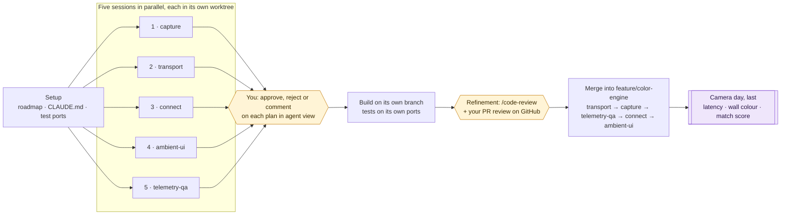

# Roadmap

Turning the hub from a hobby build into something product-grade. It closes the
gaps from the 2026-11-11 review: the capture API is on borrowed time, nothing
measures latency, protected video goes dark, the ESP8266 and Wi-Fi are the
bottleneck, there is no HDR path, it reaches no other lights, and it is hard to
use from more than one device.

Five workstreams run in parallel as background Claude Code sessions, each in its
own git worktree. Camera work comes last, on one day, with you.

## How the work flows

## One-time setup on this Mac

1. Trust the folder: in a terminal, `cd` into the repo and run `claude agents`,
   then accept the trust prompt. Agent view opens.
2. Allow the macOS prompts for **Claude Code** the first time they appear. The
   background sessions run in their own process, so they ask separately from
   your terminal:
   - Files and Folders → Downloads (the repo lives there)
   - Screen Recording (the tests capture the screen)
   - Local Network (transport reads the board once)

   If a session reports `Operation not permitted`, grant the access in System
   Settings → Privacy & Security.

## How you watch and decide

Everything runs in Claude Code's agent view; nothing custom.

| You want to | Do this |
|---|---|
| See every agent | `claude agents` in the repo. Rows are grouped by state: Working, Needs input (yellow, at the top), Completed, Failed. |
| See what needs you | The yellow rows. That is your queue: plans, questions and permission prompts. |
| Answer a question | Select the row, `Space` to peek, type your answer (or a listed choice's number), `Enter`. |
| Approve or reject a plan, or a permission prompt | Select the row, `→` to attach, answer the dialog, `←` to go back to the list. A peek reply doesn't answer dialogs. |
| Read an agent's whole log | Attach with `→`: the full conversation is the log. `Esc` on the list leaves agent view, and the sessions keep running. |
| Check from a shell | `claude logs <name>` shows recent output. |
| Approve code | Each session ends by opening a draft PR against `feature/color-engine`. Review it on GitHub, on the web or in the iPhone and iPad app: Approve, Request changes or Comment. Nothing merges without your approval. |

Every session starts in **plan mode**: it researches read-only, then stops and
asks you to approve its plan. Approve and it builds. Answer with changes and it
revises. Tell it to stop and it stops.

## Teams

| Team | Who | When |
|---|---|---|
| Research and design | each workstream session, in plan mode | now |
| Approval | you, in agent view | when a row turns yellow |
| Build | the same session after your OK, on its own branch | after approval |
| Refinement | a review session per PR (`/code-review <PR number>`, typed in agent view) | when a PR opens |
| QA | workstream 5, plus the tests in every PR | throughout |
| Camera day | you, with QA's scripts | last |

## Workstreams

Each section is the brief for one session: research first, build only after
approval.

### 1 · capture (test port base 8800)

**Why.** `ambilight/plugins/capture_quartz.py` grabs the whole display with
`CGDisplayCreateImage`, which Apple marks obsoleted in the macOS 15 SDK in
favour of ScreenCaptureKit. It also copies the full screen every frame to use
only the edges. Protected video comes back black, and the black-frame watchdog
in `engine.py` only catches black-from-the-start (missing permission), so the
strip quietly goes dark mid-film.

**Research first.**
- ScreenCaptureKit from Python. pyobjc 12.1 is installed, but
  `pyobjc-framework-ScreenCaptureKit` is not; installing it is part of your
  plan. Can `SCStream` deliver small pre-scaled frames with timestamps? What
  ms per frame and CPU would that cost compared with today?
- How to tell protected-video black (video area black, surroundings lit) from a
  genuinely dark scene. Detect and fall back; never try to bypass DRM.
- What capture returns for HDR video on an EDR display, and whether handling it
  is cheap.

**Build after approval.**
- A ScreenCaptureKit capture plugin, chosen by default where available, with
  Quartz kept as the fallback.
- A fallback to the mood look when protected video blacks out the picture.
- HDR: fix it only if it is cheap; otherwise put a written proposal in the PR.

**Files.** `ambilight/plugins/capture_*.py` plus a new plugin,
`ambilight/plugins/__init__.py`, the capture and watchdog parts of
`ambilight/engine.py`, `requirements.txt`.

**Done when.** Tests pass. CPU per frame is at or below the Quartz path, with
numbers in the PR. Synthetic protected-video frames switch to the mood look
within 1 s, and dark scenes don't.

### 2 · transport (test port base 8810)

**Why.** One ESP8266 on 2.4 GHz Wi-Fi drives about 300 LEDs (monitor plus bed)
over unauthenticated UDP that gives no feedback. The bed strip was capped at
about 201 LEDs after receive-buffer overflow crashes. A vendor article claims
WLED renders at about 42 fps internally, which would cap the 60 fps setting.

**Research first.**
- DDP support and packet format in WLED 16.0.1, cited from WLED's source.
- Whether realtime UDP is limited by WLED's render rate.
- The likely cause of the overflow, and whether DDP or a board setting fixes it.
- ESP32 options, ideally with wired Ethernet, and what would change for us.
- Hue Entertainment API requirements, as a written note only, with no build.
- The one exception to the live-hardware rule: you may read
  `GET /json/info` from the real board once, for fps, LED count, free heap and
  signal. Send nothing else.

**Build after approval.** A DDP output plugin selectable next to DNRGB, tested
against `tools/fake_wled.py` (extend the fake board to accept DDP), and a
written keep-ESP8266-or-move-to-ESP32 recommendation in the PR.

**Files.** `ambilight/plugins/output_*.py` plus a new plugin,
`ambilight/plugins/__init__.py`, `tools/fake_wled.py`, `ambilight/wled.py` if
needed.

**Done when.** DDP is selectable and tests pass. The PR shows packets per
second and bytes per second for both protocols at our LED counts.

### 3 · connect (test port base 8820)

**Why.** The user wants to control the lights from an iPhone, an iPad and the
Mac, in every situation.

**Research first.** Find how each device finds and talks to the hub today:
`server.py`, `access.py`, `discovery.py`, `web/manifest.webmanifest`,
`board/index.htm` and `macapp/Sources/Hub.swift`. Then write a scenario matrix
showing today's behaviour for each of these situations:
- first pairing on an iPhone
- an iPad as a second client at the same time
- the Mac asleep, its lid closed, or the hub stopped
- the board offline or rebooting
- a Wi-Fi drop and recovery
- the hub's or the board's IP address changing
- a PIN set, or forgotten
- the phone away from home
- the page added to the Home Screen

**Build after approval.**
- QR-code pairing.
- Automatic reconnect with clear offline states.
- A fallback to the board's own page when the hub is unreachable.
- Remote access as a written option only, with its security trade-offs.

**Files.** `ambilight/server.py`, `discovery.py`, `access.py`, the connection
parts of `ambilight/web/index.html`, `board/index.htm`,
`macapp/Sources/Hub.swift`.

**Done when.** Every row of the matrix passes or has a written manual step, and
the matrix is in the PR.

### 4 · ambient-ui (test port base 8830)

**Why.** The user wants the feel of Philips Ambilight and Hue Sync as an add-on
to the existing screens, not as a rewrite.

**Research first.**
- The Ambilight TV menu: styles for following video, audio and colour, lounge
  light, brightness, saturation, wall colour, switch-off fade, and
  Ambilight+Hue / AmbiScape.
- The Hue Sync app: modes, intensity and brightness.
- Cite your sources. Map every control to the existing settings in
  `ambilight/config.py` (profiles, blend, saturation, immersion, contrast,
  brightness, white_kelvin, bed_*), and list what exists and what is new.

**Build after approval.** One new "Ambient" tab in `ambilight/web/index.html`
and one new page in the Mac app; existing screens stay unchanged. Copy the
interaction model, not Philips' names, logos or artwork.

**Files.** `ambilight/web/index.html` (the new tab only), a new page file and
its navigation entry in `macapp/Sources`, and `ambilight/routes.py` only where a
setting has no endpoint.

**Done when.** The screen works at iPhone, iPad and Mac sizes. Tests show each
control changes the setting it claims to. Screenshots are in the PR. This
workstream merges last.

### 5 · telemetry-qa (test port base 8840)

**Why.** No number says how fast light reaches the strip, and the camera test
has to wait until the end.

**Research first.**
- Baseline today with `tools/fake_wled.py` and a sandbox hub: delivered fps,
  CPU, and time per stage wherever it can be measured.
- The test gaps in the modules that workstreams 1 to 4 will touch.

**Build after approval.**
- Per-stage timing (capture, processing, colour, send) plus delivered fps and
  dropped frames, in the status API and on the phone page.
- A soak script: hours long, checking memory stays flat and fps stays steady.
- The camera latency script. It flashes the screen edge the strip samples,
  watches the strip through the Lenovo webcam (picked by name), and reports
  median and p95 ms. It has a `--dry-run` mode with a simulated camera, so it
  can be tested now. Never open a real camera.

**Files.** Timing hooks in `ambilight/engine.py`, status in
`ambilight/routes.py`, the status card in `ambilight/web/index.html`, `tests/`,
and new scripts in `tools/`.

**Done when.** The PR shows before and after numbers, and both scripts pass in
dry-run. Camera day then only needs the webcam plugged in.

## Overlaps and merge order

Workstreams 1 and 5 both touch `engine.py`. Workstreams 3, 4 and 5 touch
`web/index.html`. Workstreams 3 and 4 touch the Mac app. Keep changes additive,
and rebase onto `feature/color-engine` before opening a PR; whichever lands
second resolves the conflicts.

Merge order: transport → capture → telemetry-qa → connect → ambient-ui. The
fewest shared files go first, and the UI goes last so it can show the new
states.

## Camera day (last)

**When.** After all five PRs are merged. Nothing before it needs a camera.
Until then, latency is measured in software by workstream 5.

**What to set up** (about 30 minutes):
- The Lenovo webcam plugged in, facing the wall behind the monitor with the
  strip in view. The built-in camera is never used.
- Room lights off, and the hub running from the merged branch.

**Steps:**
1. Latency: run workstream 5's latency script with `--camera Lenovo`. You get
   median and p95 glass-to-LED ms.
2. Wall colour: `python3 hub.py --camera-calibrate --camera Lenovo`
3. Match score: play a video, then run
   `python3 hub.py --camera-check 60 --camera Lenovo`. It should score at least
   as well as before.
